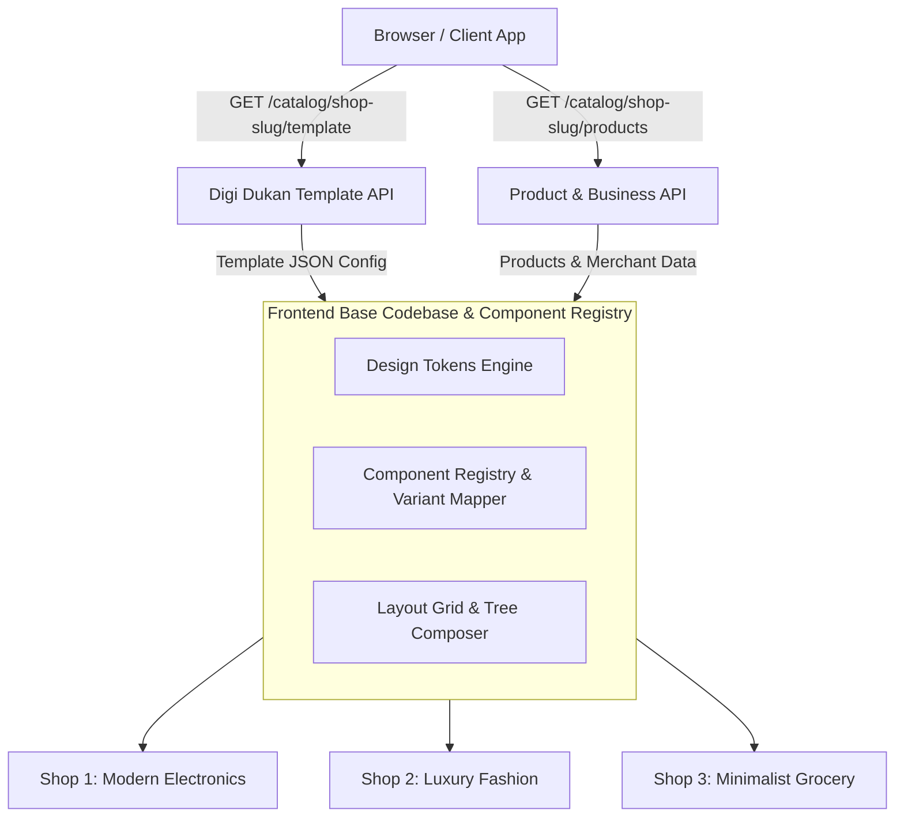
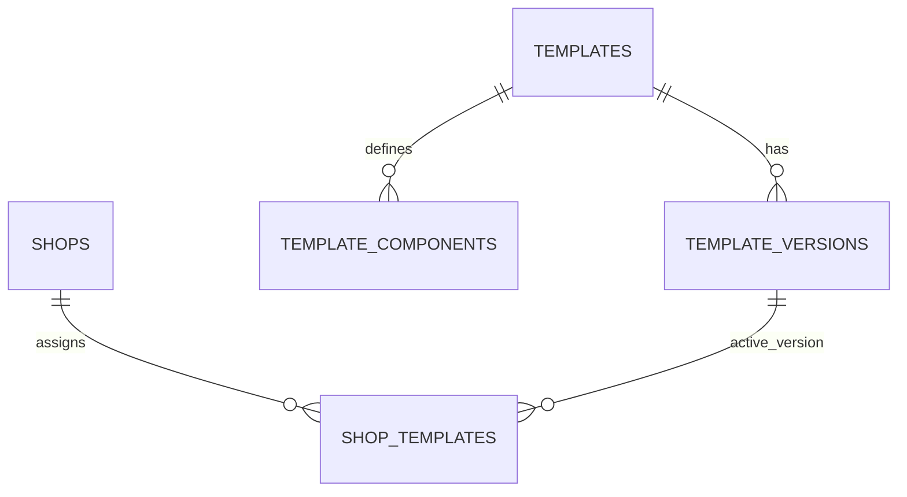
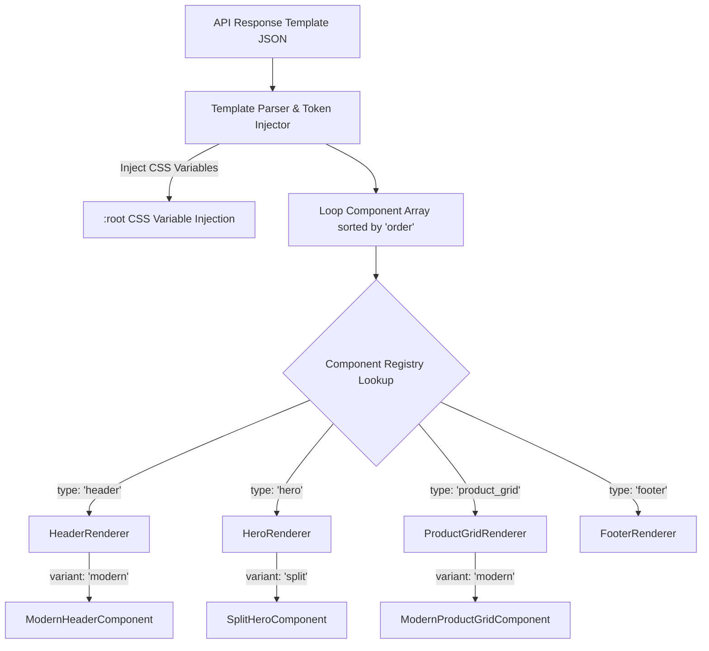

# Digi Dukan — Dynamic Web Catalog Template System Specification

> **Version**: 1.0.0  
> **Status**: Core Technical Specification  
> **Target Platform**: Digi Dukan Multi-Tenant E-Commerce & Web Catalog System

---

## Executive Summary

**Digi Dukan** is a multi-tenant web-based product catalog platform designed to serve thousands of diverse shops (electronics, fashion, grocery, luxury, restaurants, services) through a **single, unified frontend codebase**. 

Instead of creating isolated, custom frontend projects for different merchant visual identities, the Digi Dukan catalog frontend acts as a **Dynamic Render Engine**. Upon receiving a request for a shop route (e.g., `/shop1`, `/shop2`, `/shop3`), the application fetches a **Template Design Configuration JSON** from the backend. The frontend then dynamically resolves design tokens, layout grids, component ordering, visibility flags, and component variants to render a custom shop experience.



---

## 1. Template Architecture & Separation of Concerns

A fundamental architectural principle of Digi Dukan is the **strict decoupling of Visual Design from Business Data**.

### 1.1 Responsibilities of the Template System
The Template API payload dictates **ONLY** visual styling, structural arrangement, and interaction rules:
- **Design Tokens**: Color palettes, font families, typography scale, border radii, shadow elevations, spacing scales.
- **Page Layout**: Section ordering, section enablement/visibility, section padding, container max-widths.
- **Component Variants**: Visual variants for Header, Hero, Categories, Product Cards, Filters, Footers.
- **Component Settings**: Aspect ratios, toggle flags (e.g., `show_rating`, `show_wishlist`), column counts per breakpoint.
- **Responsive Behavior**: Breakpoint-specific overrides for grid columns, visibility, and navigation drawers.

### 1.2 Responsibilities of Data APIs
Business data is fetched independently through separate microservice endpoints:
- **Template API** (`/api/v1/catalog/:shop/template`): Design JSON.
- **Business API** (`/api/v1/catalog/:shop/info`): Store name, logo, phone, WhatsApp number, address, business hours, social links.
- **Category API** (`/api/v1/catalog/:shop/categories`): Category tree, names, icons, product counts.
- **Product API** (`/api/v1/catalog/:shop/products`): SKU, title, price, discount, gallery images, stock status, ratings, specifications.

```text
                               ┌────────────────────────────────┐
                               │     Client Browser Request     │
                               └───────────────┬────────────────┘
                                               │
               ┌───────────────────────────────┼───────────────────────────────┐
               ▼                               ▼                               ▼
    ┌────────────────────┐          ┌────────────────────┐          ┌────────────────────┐
    │    Template API    │          │    Business API    │          │    Product API     │
    │  (Design Config)   │          │   (Merchant Info)  │          │   (Items & Specs)  │
    └──────────┬─────────┘          └──────────┬─────────┘          └──────────┬─────────┘
               │                               │                               │
               └───────────────────────────────┼───────────────────────────────┘
                                               │
                                               ▼
                               ┌────────────────────────────────┐
                               │   Frontend Dynamic Renderer    │
                               │  (Merges Data + Component UI)  │
                               └────────────────────────────────┘
```

---

## 2. Standard Page Structure

A catalog page in Digi Dukan is represented as a tree of modular, configurable sections. Every template defines an ordered array of sections, enabling merchants to customize their storefront sequence without writing code.

### 2.1 Standard Master Section Tree
```text
Catalog Root Page
├── Header Component
├── Announcement / Promotional Bar
├── Hero Section
├── Category Navigation
├── Featured Products Section
├── Product Grid Section
├── Promotional Banner / Offer Section
├── Business / About Section
├── Contact / Location Section
└── Footer Component
```

### 2.2 Section Reordering & Hiding Examples

#### Template A (Electronics Store — Product Focused):
```text
1. Header (variant: "modern", sticky: true)
2. Hero (variant: "split", show_cta: true)
3. Category Navigation (variant: "pills")
4. Featured Products (variant: "carousel")
5. Product Grid (variant: "modern_cards", columns: 4)
6. Business Info (variant: "minimal")
7. Footer (variant: "multi_column")
```

#### Template B (Boutique Fashion — Story & Visual Driven):
```text
1. Announcement Bar (variant: "top_strip", text: "Free shipping over $100")
2. Header (variant: "centered_logo", transparent: true)
3. Hero (variant: "full_width_carousel", overlay: "gradient")
4. Promotional Section (variant: "lookbook_grid")
5. Categories (variant: "circular_cards")
6. Product Grid (variant: "luxury_cards", columns: 3)
7. Footer (variant: "minimal_dark")
```

---

## 3. Header Component Specification

The Header controls brand presence, search access, navigation links, cart drawer triggers, and mobile drawer behavior.

### 3.1 Header Variants
- `modern`: Left logo, center links, right actions (Search, Wishlist, Cart).
- `centered`: Centered logo, split navigation on left and right, right action cluster.
- `minimal`: Minimalist compact row with hamburger trigger.
- `ecommerce_dense`: Top utility bar (contact + currency) + main navigation row + sub-category bar.
- `floating`: Card-like floating header detached from top viewport edge.

### 3.2 Configurable Properties
| Field Name | Type | Description | Allowed Values |
| :--- | :--- | :--- | :--- |
| `variant` | `string` | Header layout style | `"modern" \| "centered" \| "minimal" \| "ecommerce_dense" \| "floating"` |
| `sticky` | `boolean` | Sticky top positioning on scroll | `true \| false` |
| `transparent_on_top` | `boolean` | Transparent background over Hero | `true \| false` |
| `logo_position` | `string` | Logo alignment | `"left" \| "center"` |
| `show_business_name` | `boolean` | Display text name next to logo | `true \| false` |
| `show_search` | `boolean` | Render search bar or icon | `true \| false` |
| `show_cart` | `boolean` | Render cart / enquiry drawer icon | `true \| false` |
| `show_wishlist` | `boolean` | Render wishlist icon button | `true \| false` |
| `show_navigation` | `boolean` | Render horizontal category/page links | `true \| false` |
| `height` | `number` | Desktop header height in pixels | `60` to `100` |
| `mobile_behavior` | `string` | Mobile layout format | `"drawer" \| "bottom_bar" \| "minimal_inline"` |

### 3.3 Header JSON Schema Example
```json
{
  "id": "header_main",
  "type": "header",
  "variant": "modern",
  "enabled": true,
  "order": 1,
  "settings": {
    "sticky": true,
    "transparent_on_top": false,
    "logo_position": "left",
    "show_business_name": true,
    "show_search": true,
    "show_cart": true,
    "show_wishlist": true,
    "show_navigation": true,
    "height": 72,
    "mobile_behavior": "drawer"
  }
}
```

---

## 4. Hero Section Specification

The Hero section serves as the primary visual anchor for merchant branding and campaign highlights.

### 4.1 Hero Variants
- `full_width`: Background image spanning 100% viewport width with centered text card.
- `split`: 2-column layout (Text & CTA on left, image/video asset on right).
- `image_focused`: High-impact hero with minimal text overlay.
- `minimal`: Clean typographic headline with subtle background pattern.
- `product_focused`: Highlights a featured product with price badge & instant buy button.
- `promotional`: Includes countdown timer and promotional badge.

### 4.2 Hero JSON Schema Example
```json
{
  "id": "hero_primary",
  "type": "hero",
  "variant": "split",
  "enabled": true,
  "order": 2,
  "settings": {
    "min_height": 540,
    "alignment": "left",
    "image_position": "right",
    "show_cta": true,
    "cta_text": "Explore Catalog",
    "cta_variant": "primary",
    "overlay_opacity": 0.15,
    "border_radius": "xl",
    "text_max_width": "600px"
  }
}
```

---

## 5. Category Section Specification

Defines how product taxonomy is displayed for navigation filtering.

### 5.1 Category Variants
- `horizontal_scroll`: Single row horizontally scrollable chips or cards.
- `grid`: Multi-column responsive grid.
- `circular_categories`: Round avatar-style icon cards (popular for mobile & story layouts).
- `image_cards`: Full cards with background images, title, and item count overlay.
- `minimal_text_categories`: Pure text pill buttons with active indicators.
- `bento_grid`: Unequal bento-box style feature cards.

### 5.2 Category JSON Schema Example
```json
{
  "id": "category_nav",
  "type": "categories",
  "variant": "horizontal_scroll",
  "enabled": true,
  "order": 3,
  "settings": {
    "columns": { "mobile": 2, "tablet": 4, "desktop": 6 },
    "card_variant": "image_cards",
    "aspect_ratio": "1:1",
    "show_item_count": true,
    "gap": "md",
    "card_radius": "lg"
  }
}
```

---

## 6. Product Grid & Product Card Specifications

The Product Grid and Card engine is the core conversion driver of Digi Dukan.

### 6.1 Product Card Variants
- `minimal`: Image + Title + Price. Clean and distraction-free.
- `modern`: Standard e-commerce card with hover zoom, tag badges, price line, and subtle shadow.
- `ecommerce`: Complete card with ratings, original vs discount price, stock indicator, and dual CTA buttons.
- `image_focused`: Overlay text directly on top of high-aspect product photo.
- `compact`: Dense grid items designed for quick high-volume browsing (e.g., grocery/pharmacy).
- `horizontal`: Row item layout with thumbnail left and details right.
- `luxury`: Elegant typography, high whitespace, borderless image placement.
- `rounded`: Soft curved cards with prominent rounded add buttons.

### 6.2 Product Card Configurable Flags & Properties
```text
ProductCard Settings
├── image_aspect_ratio   : "1:1" | "3:4" | "4:3" | "16:9"
├── hover_effect         : "zoom" | "lift" | "border_highlight" | "none"
├── show_price           : boolean
├── show_old_price       : boolean
├── show_discount_badge  : boolean
├── show_rating          : boolean
├── show_category_tag    : boolean
├── show_wishlist_button : boolean
├── show_add_button      : boolean
├── add_button_type      : "icon_only" | "full_button" | "quantity_stepper"
├── show_stock_status    : boolean
├── border_style         : "none" | "solid" | "subtle"
└── shadow_elevation     : "none" | "sm" | "md" | "lg"
```

### 6.3 Product Grid JSON Schema Example
```json
{
  "id": "featured_products_grid",
  "type": "product_grid",
  "variant": "modern",
  "enabled": true,
  "order": 4,
  "settings": {
    "section_title": "Featured Collections",
    "columns": {
      "mobile": 2,
      "tablet": 3,
      "desktop": 4,
      "large_desktop": 4
    },
    "gap": "lg",
    "product_card": {
      "variant": "ecommerce",
      "image_aspect_ratio": "3:4",
      "hover_effect": "zoom",
      "show_price": true,
      "show_old_price": true,
      "show_discount_badge": true,
      "show_rating": true,
      "show_category_tag": true,
      "show_wishlist_button": true,
      "show_add_button": true,
      "add_button_type": "full_button",
      "show_stock_status": true,
      "border_style": "subtle",
      "shadow_elevation": "sm",
      "card_radius": "md"
    }
  }
}
```

---

## 7. Product Detail Page (PDP) Specification

The template schema also governs the Product Detail view layout contract when a user selects an individual item.

### 7.1 PDP Component Variants
- `split_equal`: 50/50 split (Gallery left, Product information right).
- `gallery_sticky`: Gallery scrolls vertically while details stay fixed in viewport.
- `full_width_carousel`: Full width media carousel top, specifications below.
- `compact_modal`: Modal popup view over catalog context.

### 7.2 PDP Settings Schema
```json
{
  "type": "product_detail",
  "variant": "split_equal",
  "settings": {
    "gallery_type": "thumbnails_left",
    "gallery_aspect_ratio": "1:1",
    "show_share_buttons": true,
    "show_specs_table": true,
    "show_related_products": true,
    "related_products_count": 4,
    "sticky_bottom_bar_mobile": true,
    "primary_action": "whatsapp_enquiry"
  }
}
```

---

## 8. Promotional Components

Reusable promotional banner modules inserted anywhere in the section sequence.

### 8.1 Variants
- `promotional_banner`: Wide image banner with text & button overlay.
- `discount_banner`: Colored box with promo code copy button.
- `cta_section`: Highlight box encouraging store contact or newsletter subscription.
- `announcement_bar`: Thin top bar for broadcast notices.

### 8.2 JSON Schema Example
```json
{
  "id": "promo_festive",
  "type": "promotional_banner",
  "variant": "discount_banner",
  "enabled": true,
  "order": 5,
  "settings": {
    "headline": "Festive Electronics Sale — Up to 30% Off",
    "badge_text": "Limited Time",
    "button_text": "Claim Offer",
    "bg_color": "var(--primary)",
    "text_color": "#ffffff",
    "border_radius": "lg"
  }
}
```

---

## 9. Business / About Section

Displays merchant identity, store narrative, physical location, and contact details.

### 9.1 Variants
- `centered`: Centered logo, short bio, key contact metrics.
- `two_column`: Story text left, store photo or Google Map embedded right.
- `minimal`: Single line business bio with social icon row.
- `contact_cards`: Grid of cards (Phone, WhatsApp, Address, Store Hours).

---

## 10. Footer Component Specification

Defines the bottom navigation, copyright notices, and merchant contact links.

### 10.1 Variants
- `minimal`: Copyright + Social links single row.
- `multi_column`: Brand summary column + Categories list + Legal links + Socials.
- `dark`: High-contrast dark container regardless of page light mode.
- `ecommerce_full`: Includes newsletter signup form, payment badges, category lists, and powered-by badge.

### 10.2 JSON Schema Example
```json
{
  "id": "footer_main",
  "type": "footer",
  "variant": "multi_column",
  "enabled": true,
  "order": 10,
  "settings": {
    "show_business_info": true,
    "show_category_links": true,
    "show_social_links": true,
    "show_copyright": true,
    "show_powered_by": true,
    "background_style": "surface",
    "padding_vertical": "xl"
  }
}
```

---

## 11. Design Tokens System

Design Tokens represent the low-level CSS custom variables that inject color, typography, spacing, border-radius, and shadow attributes into all components.

```text
Theme Tokens Object
├── Colors (primary, surface, text, status)
├── Typography (families, weights, sizes, line heights)
├── Spacing Scale (xs, sm, md, lg, xl, 2xl, 3xl)
├── Border Radius (none, sm, md, lg, xl, full)
└── Shadows (none, sm, md, lg, xl)
```

### 11.1 Color Tokens
```json
{
  "colors": {
    "primary": "#2f4630",
    "primary_hover": "#22331f",
    "primary_foreground": "#ffffff",
    "secondary": "#6f906b",
    "secondary_foreground": "#ffffff",
    "background": "#ffffff",
    "surface": "#f8f9fa",
    "surface_hover": "#f1f3f5",
    "text_primary": "#121412",
    "text_secondary": "#5c615b",
    "text_muted": "#8c918a",
    "border": "#e7e9e5",
    "success": "#2e7d32",
    "error": "#d32f2f",
    "warning": "#ed6c02"
  }
}
```

### 11.2 Typography Tokens
```json
{
  "typography": {
    "font_family": "'Inter Tight', system-ui, -apple-system, sans-serif",
    "heading_font_family": "'Inter Tight', system-ui, sans-serif",
    "weights": {
      "regular": 400,
      "medium": 500,
      "semibold": 600,
      "bold": 700
    },
    "sizes": {
      "h1": { "size": "42px", "line_height": "1.1", "letter_spacing": "-0.025em" },
      "h2": { "size": "32px", "line_height": "1.2", "letter_spacing": "-0.02em" },
      "h3": { "size": "24px", "line_height": "1.3", "letter_spacing": "-0.01em" },
      "body_lg": { "size": "18px", "line_height": "1.5" },
      "body_md": { "size": "15px", "line_height": "1.5" },
      "body_sm": { "size": "13px", "line_height": "1.4" },
      "caption": { "size": "11px", "line_height": "1.3" }
    }
  }
}
```

### 11.3 Standardized Spacing Scale
*Why standardized tokens are mandatory*: Using an explicit token scale (`xs` to `3xl`) guarantees visual rhythm and prevents random, fragmented pixel values across different components.

```json
{
  "spacing": {
    "xs": "4px",
    "sm": "8px",
    "md": "16px",
    "lg": "24px",
    "xl": "32px",
    "2xl": "48px",
    "3xl": "64px"
  }
}
```

### 11.4 Border Radius Tokens
```json
{
  "radius": {
    "none": "0px",
    "sm": "6px",
    "md": "12px",
    "lg": "18px",
    "xl": "24px",
    "full": "9999px"
  }
}
```

### 11.5 Elevation & Shadow Tokens
```json
{
  "shadows": {
    "none": "none",
    "sm": "0 1px 3px rgba(0,0,0,0.05), 0 1px 2px rgba(0,0,0,0.1)",
    "md": "0 4px 6px -1px rgba(0,0,0,0.07), 0 2px 4px -1px rgba(0,0,0,0.04)",
    "lg": "0 10px 15px -3px rgba(0,0,0,0.08), 0 4px 6px -2px rgba(0,0,0,0.03)",
    "xl": "0 20px 25px -5px rgba(0,0,0,0.1), 0 10px 10px -5px rgba(0,0,0,0.04)"
  }
}
```

---

## 12. Layout System & Container Rules

Defines container widths, grid tracks, and page margins.

```json
{
  "layout": {
    "max_width": "1280px",
    "container_padding": {
      "desktop": "32px",
      "tablet": "24px",
      "mobile": "16px"
    },
    "section_spacing": {
      "desktop": "64px",
      "tablet": "48px",
      "mobile": "32px"
    }
  }
}
```

---

## 13. Responsive Design & Breakpoints

Digi Dukan standardizes 4 hardware breakpoints across all rendering rules:

```text
Breakpoint Scale:
├── mobile          : < 640px
├── tablet          : 640px – 1023px
├── desktop         : 1024px – 1439px
└── large_desktop   : ≥ 1440px
```

### 13.1 Responsive Configuration Contract Example
```json
{
  "columns": {
    "mobile": 2,
    "tablet": 3,
    "desktop": 4,
    "large_desktop": 5
  },
  "visibility": {
    "mobile": true,
    "tablet": true,
    "desktop": true,
    "large_desktop": true
  }
}
```

---

## 14. Generic Component Configuration Model

Every entry in the `components` array follows a standardized, validated schema wrapper:

```json
{
  "$schema": "https://json-schema.org/draft/2020-12/schema",
  "type": "object",
  "required": ["id", "type", "variant", "order", "enabled", "settings"],
  "properties": {
    "id": { "type": "string", "description": "Unique instance identifier" },
    "type": { "type": "string", "description": "Component registry key" },
    "variant": { "type": "string", "description": "Visual sub-variant name" },
    "order": { "type": "integer", "description": "Vertical rendering sequence position" },
    "enabled": { "type": "boolean", "description": "Master visibility toggle" },
    "settings": { "type": "object", "description": "Variant-specific property dictionary" }
  }
}
```

---

## 15. Complete Production Template JSON Example

Below is a complete, real-world Template Configuration JSON payload for template `modern_green_01`:

```json
{
  "template_id": "modern_green_01",
  "name": "Modern Sage Electronics",
  "version": "1.0.0",
  "category": "Electronics",
  
  "theme": {
    "colors": {
      "primary": "#2f4630",
      "primary_hover": "#22331f",
      "primary_foreground": "#ffffff",
      "secondary": "#6f906b",
      "secondary_foreground": "#ffffff",
      "background": "#ffffff",
      "surface": "#f8f9fa",
      "surface_hover": "#f2f6f0",
      "text_primary": "#121412",
      "text_secondary": "#5c615b",
      "border": "#e7e9e5",
      "success": "#2f4630",
      "error": "#d32f2f"
    },
    "typography": {
      "font_family": "'Inter Tight', system-ui, sans-serif",
      "weights": { "regular": 400, "medium": 500, "semibold": 600, "bold": 700 }
    },
    "spacing": {
      "xs": "4px", "sm": "8px", "md": "16px", "lg": "24px", "xl": "32px", "2xl": "48px"
    },
    "radius": {
      "sm": "6px", "md": "12px", "lg": "18px", "full": "9999px"
    },
    "shadows": {
      "sm": "0 1px 3px rgba(0,0,0,0.05)",
      "md": "0 4px 6px -1px rgba(0,0,0,0.07)"
    }
  },

  "layout": {
    "max_width": "1320px",
    "container_padding": { "desktop": "28px", "tablet": "20px", "mobile": "16px" }
  },

  "components": [
    {
      "id": "header_01",
      "type": "header",
      "variant": "modern",
      "order": 1,
      "enabled": true,
      "settings": {
        "sticky": true,
        "show_search": true,
        "show_cart": true,
        "show_wishlist": true,
        "show_navigation": true,
        "height": 72
      }
    },
    {
      "id": "hero_01",
      "type": "hero",
      "variant": "split",
      "order": 2,
      "enabled": true,
      "settings": {
        "min_height": 520,
        "alignment": "left",
        "image_position": "right",
        "show_cta": true,
        "cta_text": "Shop Collection"
      }
    },
    {
      "id": "categories_01",
      "type": "categories",
      "variant": "horizontal_scroll",
      "order": 3,
      "enabled": true,
      "settings": {
        "columns": { "mobile": 2, "tablet": 4, "desktop": 6 },
        "card_variant": "image_cards",
        "show_item_count": true
      }
    },
    {
      "id": "products_01",
      "type": "product_grid",
      "variant": "modern",
      "order": 4,
      "enabled": true,
      "settings": {
        "section_title": "Latest Arrivals",
        "columns": { "mobile": 2, "tablet": 3, "desktop": 4 },
        "product_card": {
          "variant": "ecommerce",
          "image_aspect_ratio": "1:1",
          "show_price": true,
          "show_old_price": true,
          "show_add_button": true,
          "show_wishlist_button": true
        }
      }
    },
    {
      "id": "footer_01",
      "type": "footer",
      "variant": "multi_column",
      "order": 5,
      "enabled": true,
      "settings": {
        "show_business_info": true,
        "show_social_links": true,
        "show_copyright": true
      }
    }
  ]
}
```

---

## 16. Template API Design

### 1. Endpoint Architecture
- `GET /api/v1/templates`: List all available master templates in the system.
- `GET /api/v1/templates/:template_id`: Get raw master template configuration.
- `GET /api/v1/catalog/:shop_slug/template`: **Primary Merchant Endpoint**. Resolves the active template assigned to a specific shop slug, returning merged design tokens and component overrides.

### 2. Conceptual Disambiguation Matrix

| Term | Definition | Example |
| :--- | :--- | :--- |
| **Template** | Master JSON document defining layout, tokens, components | `modern_green_01` |
| **Theme** | Set of visual design tokens (Colors, Typography, Radius) | Primary: `#2f4630`, Radius: `12px` |
| **Component** | Structural section block type | `"header"`, `"product_grid"` |
| **Variant** | Specific visual rendering style for a component | `"split"` hero vs `"full_width"` hero |
| **Configuration** | Merchant-specific setting overrides | `show_rating: false` |
| **Business Data** | Real-world merchant attributes | Store Name, Address, WhatsApp # |
| **Product Data** | Merchant items database records | Price, Stock, Images, Title |

---

## 17. Database Design & Storage Schema

Below is the database structure required to persist templates and shop assignments cleanly.



### SQL Schema Definition
```sql
-- 1. MASTER TEMPLATES TABLE
CREATE TABLE templates (
    id VARCHAR(50) PRIMARY KEY, -- e.g. 'modern_01'
    name VARCHAR(100) NOT NULL,
    category VARCHAR(50) NOT NULL, -- e.g. 'Electronics', 'Fashion'
    description TEXT,
    thumbnail_url TEXT,
    is_active BOOLEAN DEFAULT TRUE,
    created_at TIMESTAMP WITH TIME ZONE DEFAULT CURRENT_TIMESTAMP
);

-- 2. TEMPLATE VERSIONS TABLE (Protects existing shops from breaking changes)
CREATE TABLE template_versions (
    id SERIAL PRIMARY KEY,
    template_id VARCHAR(50) REFERENCES templates(id) ON DELETE CASCADE,
    version VARCHAR(20) NOT NULL, -- e.g. '1.0.0', '1.1.0'
    schema_json JSONB NOT NULL, -- Full theme tokens + components JSON
    created_at TIMESTAMP WITH TIME ZONE DEFAULT CURRENT_TIMESTAMP,
    UNIQUE(template_id, version)
);

-- 3. SHOP TEMPLATE ASSIGNMENTS & OVERRIDES
CREATE TABLE shop_templates (
    id SERIAL PRIMARY KEY,
    shop_id INT NOT NULL UNIQUE, -- Foreign key to merchant shop table
    template_id VARCHAR(50) REFERENCES templates(id),
    template_version_id INT REFERENCES template_versions(id),
    custom_tokens_override JSONB DEFAULT '{}'::jsonb, -- Per-shop color/logo tweaks
    custom_components_override JSONB DEFAULT '[]'::jsonb, -- Per-shop section toggles
    updated_at TIMESTAMP WITH TIME ZONE DEFAULT CURRENT_TIMESTAMP
);
```

---

## 18. Frontend Rendering Architecture & Component Registry

The frontend dynamic rendering engine works through a **Component Registry Pattern**.



### Component Registry Implementation Pattern (React Conceptual Example)
```javascript
// ComponentRegistry.js
import { ModernHeader, CenteredHeader } from './components/header';
import { SplitHero, FullWidthHero } from './components/hero';
import { ModernProductGrid, CompactProductGrid } from './components/products';

const COMPONENT_REGISTRY = {
  header: {
    modern: ModernHeader,
    centered: CenteredHeader,
  },
  hero: {
    split: SplitHero,
    full_width: FullWidthHero,
  },
  product_grid: {
    modern: ModernProductGrid,
    compact: CompactProductGrid,
  }
};

export function DynamicSectionRenderer({ sectionData, businessData, productData }) {
  const { type, variant, enabled, settings } = sectionData;
  if (!enabled) return null;

  const TargetComponent = COMPONENT_REGISTRY[type]?.[variant];
  if (!TargetComponent) {
    console.warn(`Missing component variant for type: ${type}, variant: ${variant}`);
    return null;
  }

  return <TargetComponent settings={settings} business={businessData} products={productData} />;
}
```

---

## 19. Core Architectural Rule

> [!IMPORTANT]
> **NEVER CREATE SEPARATE FRONTEND REPOSITORIES OR BUILD ARTIFACTS FOR DIFFERENT TEMPLATES.**

```text
       ┌─────────────────────────────────────────────────────────┐
       │             ONE SINGLE FRONTEND CODEBASE                │
       └────────────────────────────┬────────────────────────────┘
                                    │
                                    ├── Reusable Base Components
                                    ├── Variant Sub-Components
                                    ├── Dynamic Design Token Engine
                                    └── Component Registry Mapper
                                    │
                                    ▼
       ┌─────────────────────────────────────────────────────────┐
       │     API CONFIGURATION JSON (Driven by Database)         │
       └────────────────────────────┬────────────────────────────┘
                                    │
                                    ▼
       ┌─────────────────────────────────────────────────────────┐
       │      UNLIMITED UNIQUE SHOP FRONTS & VISUAL DESIGNS      │
       └─────────────────────────────────────────────────────────┘
```

For example, a single `<ProductCard />` abstraction supports all variant renderers:
```text
ProductCard Component Family
 ├── ProductCardMinimal.jsx
 ├── ProductCardModern.jsx
 ├── ProductCardEcommerce.jsx
 ├── ProductCardHorizontal.jsx
 └── ProductCardLuxury.jsx
```

---

## 20. Template Versioning Strategy

To guarantee that updating a master template does not break existing published merchant stores:

1. **Semantic Versioning**: All templates carry a semantic version string (`v1.0.0`, `v1.1.0`, `v2.0.0`).
2. **Immutable Versions**: Published template version records in `template_versions` are immutable.
3. **Migration Paths**: When releasing a major version (`v2.0.0`), existing shops remain pinned to `v1.0.0` until they explicitly choose to upgrade via their Merchant Dashboard.

---

## 21. Template Categories & Discovery

Template categories are metadata tags used in template selection galleries and recommendation algorithms:

- 👗 **Fashion & Apparel**: High whitespace, aspect ratio `3:4`, luxury typography.
- 📱 **Electronics & Tech**: Dense spec tables, dark header modes, discount badges.
- 🍏 **Grocery & Essentials**: Compact horizontal rows, quantity stepper add buttons.
- 🍽️ **Restaurants & Food**: Circular category avatars, prominent WhatsApp ordering.
- 🛋️ **Furniture & Home**: Bento box imagery, full-width hero split.
- 💍 **Jewelry & Luxury**: Elegant subtle borders, borderless image cards.
- 💄 **Beauty & Cosmetics**: Soft pink/sage pastel design tokens, grid spacing.

---

## 22. Performance Considerations & Optimization

To maintain sub-second load times despite hosting complex dynamic variants:

1. **CSS Variable Injections**: Convert Design Tokens into `:root` CSS variables in a single micro-task to avoid recalculating style sheets.
2. **Variant Level Code-Splitting**: Use dynamic imports (`React.lazy()`) inside the Component Registry so the browser only downloads component code for the active template variants.
3. **Template API Caching**: Cache `/catalog/:shop/template` payloads at edge CDNs with an `ETag` and a 5-minute `Stale-While-Revalidate` header.
4. **Conditional Data Fetching**: If a template has `enabled: false` for `reviews` or `featured_products`, the frontend skips executing those secondary product API queries entirely.

---

## 23. Schema Validation & Guardrails

Before a template JSON is saved in the database, it must pass rigid schema validation:

```text
Validation Suite Rules:
✓ hex_color_check   : Ensures all colors match /^#([A-Fa-f0-9]{6})$/
✓ valid_registry    : Ensures 'type' and 'variant' match registered frontend components
✓ unique_orders     : Ensures section 'order' values are non-conflicting integers
✓ required_tokens   : Validates presence of primary, background, surface, and text_primary
✓ breakpoint_keys   : Verifies column objects contain 'mobile', 'tablet', and 'desktop'
```

---

## 24. Future System Extensibility Roadmap

The Digi Dukan Template System is architected to natively support upcoming advanced platform features:

- 🖱️ **Drag-and-Drop Page Builder**: Merchant admin UI manipulating component `order` and `enabled` parameters visually.
- 🪄 **AI-Generated Templates**: Prompt-to-Template pipeline outputting valid Schema JSON based on store descriptions.
- 🧪 **A/B Testing Engine**: Serving Template JSON A to 50% of traffic and Template JSON B to 50% of traffic to compare conversion rates.
- 🛒 **Template Marketplace**: Third-party designers publishing validated JSON templates for merchant purchase.

---

## 25. Master System Summary Architecture

```text
                                  DIGI DUKAN PLATFORM
                                           │
                   ┌───────────────────────┴───────────────────────┐
                   │                                               │
         Template Service API                            Catalog Data Services
      (Design Tokens & Layout)                        (Products, Merchant Info)
                   │                                               │
                   └───────────────────────┬───────────────────────┘
                                           │
                                           ▼
                             Dynamic Catalog Frontend
                                           │
                      ┌────────────────────┴────────────────────┐
                      │    CSS Variable Theme Injection        │
                      │    Component Registry Variant Resolver  │
                      └────────────────────┬────────────────────┘
                                           │
          ┌────────────────────────────────┼────────────────────────────────┐
          ▼                                ▼                                ▼
   Header Component                 Hero Component                  Products Grid
 (Modern/Minimal/Centered)       (Split/Full/Product)           (Ecommerce/Minimal/Luxury)
          │                                │                                │
          └────────────────────────────────┼────────────────────────────────┘
                                           │
                                           ▼
                                Dynamic Render Output
```
